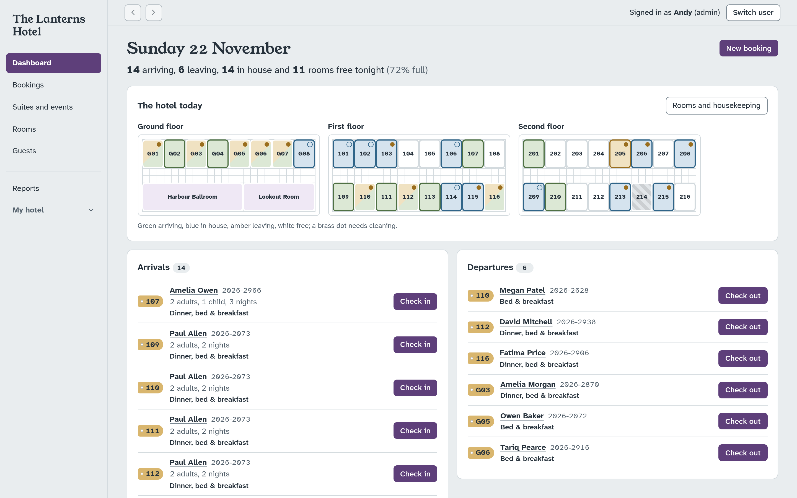

# DesktopBooker

**Hotel booking software for small, independent hotels. It runs on your own computer, works without the internet and costs nothing to use.**

DesktopBooker runs the front desk of a family-run hotel: bookings, rooms and housekeeping, function suites and weddings, bills and payments, guests and reports. There's no subscription, no per-room fee and no website to log in to. Everything is kept in one file on the hotel's own PC, and it's backed up every day.

<picture>
  <source media="(prefers-color-scheme: dark)" srcset="docs/guide/images/dashboard-dark.webp">
  
</picture>

**▶ [Watch a two-minute tour on YouTube](https://youtu.be/LJkDCH-TEdo)**

## Why DesktopBooker

- **No monthly fees.** Install it and use it. No subscription, no commission, no contract.
- **Your data stays in the hotel.** Guest details never leave your computer. Backups go where you choose: a USB stick, a network drive, OneDrive or Dropbox.
- **Works when the internet doesn't.** The booking calendar, bills and room plan all work offline. Only sending emails needs a connection.
- **Made for the front desk.** One-click check-in and check-out, a calendar of every room, and a floor plan that shows who's in, who's arriving and which rooms need cleaning.
- **Everyone signs in with their own PIN.** Staff can take bookings and check guests in; only admins can change prices, see the takings and run reports. Every change is recorded in an audit log.
- **Windows, macOS and Linux.**

## A day at the hotel

### 1. A booking over the phone
Mrs Hughes rings to book a sea-view double for two nights next month, with breakfast. She's bringing the dog and the car.

▶ [Watch a booking taken over the phone (1 min)](https://youtu.be/jC87SadvN1o)

1. Open **Bookings**. The **Calendar** shows every room against the coming nights; free nights are white.
2. Click a free night in a suitable room, or press **New booking**.
3. Start typing her name: if she's stayed before, choose her and her details fill in.
4. Set the dates, the room and **Bed & breakfast**. Under **Room must have**, press **Pets allowed**: rooms that don't allow dogs are greyed out. Set **Cars to park** to 1.
5. The price appears straight away, night by night: the room, any extra guests, breakfast and parking.
6. Choose **Phone** as the source and press **Make booking**. She gets a booking number such as *2026-0042*.
7. Press **Email the guest → Send confirmation** to send her a confirmation from the hotel's own email account. If she pays a deposit by card, open the **Bill**, press **Record a payment** and tick it as a deposit.

The same room can never be booked twice for the same night: DesktopBooker refuses before it happens.

### 2. Checking in
On the day, Mrs Hughes is under **Arrivals** on the **Dashboard**, with her room, booking number, number of guests and board. Press **Check in**. On the room plan her room turns blue: *in house*.

▶ [Watch check-in, dinner on the bill and check-out (1 min)](https://youtu.be/H9vWlVG19M4)

### 3. Dinner in the restaurant
That evening she and her husband have dinner and a bottle of wine, to be paid when they leave.

1. Find the booking: search her name under **Bookings**, or click her name on the calendar.
2. In the **Bill**, under **Add to the bill**, choose **Food**, type *Dinner for two*, enter the amount and press **Add to bill**. Do the same for the wine under **Drinks**.

Each line takes the right VAT rate for its kind (food, drinks, rooms and so on), as set up by the hotel.

### 4. Checking out and paying the bill
On her last morning she's under **Departures** on the dashboard.

1. Open her **Bill**. It lists the room nights, breakfasts, parking, the dinner and the wine, less her deposit, with the **Balance due**.
2. **Record a payment** for the balance: card, cash, bank transfer, cheque or voucher.
3. **Issue invoice** gives it a number and fixes it so it can't change later; **Print or save as PDF** prints it or saves a copy to email.
4. Press **Check out**.

### 5. Housekeeping
Every morning, every room someone slept in last night is marked **Dirty** automatically, so stayovers are serviced as well as departures.

▶ [Watch housekeeping (½ min)](https://youtu.be/VEVz8HKKmKA)

1. Open **Rooms**. Each floor's plan shows which rooms are arriving, in house or leaving, with a marker on the ones to clean. The **Cards** view is a simple list for housekeepers.
2. As rooms are done, mark them **Clean**, then **Ready** once checked. **Mark floor clean** does a whole floor at once.
3. **Daily lists** prints today's arrivals, departures and everyone staying tonight with their board, for the kitchen and the housekeepers.

### And also
- **Weddings and conferences:** book the function suites by the hour, plan catering sittings and dietary needs, and hold a block of bedrooms for guests that goes back on sale on a release date. ▶ [Watch](https://youtu.be/46p84bNiXc4)
- **The end of the month:** occupancy, revenue, average room rate and RevPAR at a glance, or build your own reports and dashboards, and save any of them as a spreadsheet. ▶ [Watch](https://youtu.be/6-SPKQ1CB9w)

## Features

| | | Video |
|---|---|---|
| [Front desk](docs/guide/front-desk.md) | The dashboard, check-in and check-out, daily lists | [▶ Check-in to check-out](https://youtu.be/H9vWlVG19M4) |
| [Bookings](docs/guide/bookings.md) | The calendar, taking and changing bookings, prices, parking, emails | [▶ A phone booking](https://youtu.be/jC87SadvN1o) |
| [Rooms and housekeeping](docs/guide/rooms.md) | Floor plans, room cards, dirty / clean / ready, room features | [▶ Housekeeping](https://youtu.be/VEVz8HKKmKA) |
| [Suites and events](docs/guide/suites-events.md) | Function suite hire, weddings and conferences, room blocks | [▶ A wedding](https://youtu.be/46p84bNiXc4) |
| [Bills and payments](docs/guide/bills.md) | Charges, payments and deposits, invoices, VAT | [▶ The bill](https://youtu.be/H9vWlVG19M4) |
| [Guests](docs/guide/guests.md) | Guest history, merging duplicates, data protection requests | [▶ Guests](https://youtu.be/xnGgMeCaw0w) |
| [Reports](docs/guide/reports.md) | Standard reports, your own reports and dashboards, spreadsheets | [▶ Reports](https://youtu.be/6-SPKQ1CB9w) |
| [Setting up your hotel](docs/guide/setup.md) | Floors and rooms, rates and board, VAT, users and PINs, email | [▶ Setting up](https://youtu.be/nY84UvOYTGg) · [▶ Staff and audit](https://youtu.be/sy0wPAltp5w) |
| [Backups](docs/guide/backups.md) | Daily backups, where to keep them, restoring |  |

Start with the [user guide](docs/guide/README.md).

## Getting it

Installers for Windows (`.msi` or `.exe`), macOS (`.dmg`) and Linux (`AppImage`, `.deb` or `.rpm`) are on the [Releases](../../releases) page. They aren't signed yet, so Windows and macOS ask for confirmation the first time you open it.

The first time it runs, it asks you to create the first admin (a name and a 4 to 8 digit PIN). To look around first, choose **Load demo hotel** on the dashboard.

## For developers

DesktopBooker is written in Rust (Tauri 2) with a Svelte front end and an SQLite database. See [docs/DEVELOPMENT.md](docs/DEVELOPMENT.md) to build it, run the tests and find your way around the code.

## Licence

Free to use and to change, including to run your own hotel. It may not be sold, or offered as a paid service built on it. (MIT with the Commons Clause; the licence file is added when the project is published.)
