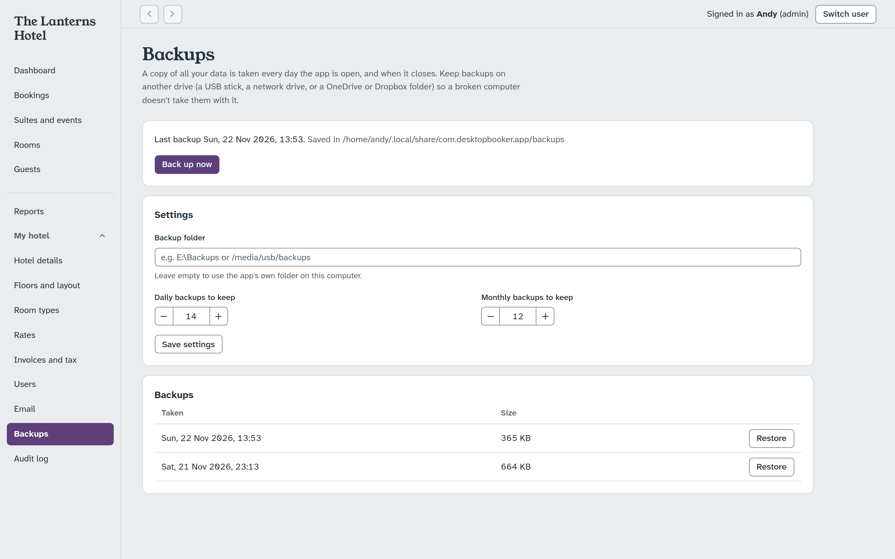

# Backups

Everything is in one database file on the hotel's computer, so backups matter.

<picture>
  <source media="(prefers-color-scheme: dark)" srcset="images/setup-backups-dark.webp">
  
</picture>

- DesktopBooker backs up once a day while it's open, and again when it closes.
- It keeps one backup for each of the last 14 days and one for each of the last 12 months.
- Choose where they go in **My hotel → Backups**: a USB stick, a network drive, or a OneDrive or Dropbox folder is best, so they survive if the computer doesn't. **Back up now** takes one straight away.
- The dashboard warns if no backup has been taken in a day or the backup folder can't be reached.

## Restoring
Choose a backup and **Restore**. DesktopBooker first takes a backup of the data as it is now, then replaces it and restarts. If you restored the wrong one, restore the backup it just made.

Never keep the live database itself in a cloud-synced or network folder; only the backups.

[Back to the guide](README.md)
