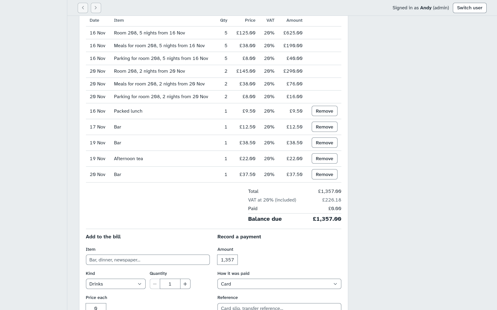
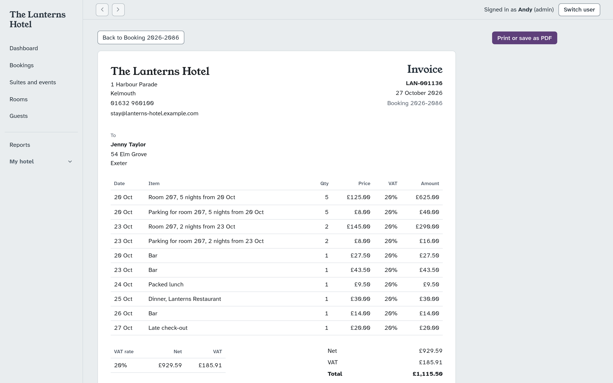

# Bills and payments

**▶ [Watch a bill from check-in to invoice](https://youtu.be/H9vWlVG19M4)**

Every booking, suite hire and event has a **Bill**.

## What's on it

<picture>
  <source media="(prefers-color-scheme: dark)" srcset="images/bill-dark.webp">
  
</picture>
- **Rooms, board and parking**, worked out from the booking and grouped by price ("Room 101, 2 nights from 19 Jun").
- **Suite hire** at the price it was booked at.
- **Extras** added by hand: under **Add to the bill**, choose the kind (food, drinks, other…), what it was, the quantity and the amount, then **Add to bill**. Use this for the restaurant, the bar, newspapers and anything else.

Each line carries the VAT rate for its kind, as set under **My hotel → Invoices and tax**, so the bill shows the VAT and the total.

## Payments and deposits
**Record a payment**: the amount, **How it was paid** (cash, card, bank transfer, cheque, voucher or other), a reference, and whether it's a deposit. Refunds are payments the other way. The bill shows what's been **Paid** and the **Balance due**.

## Invoices
**Issue invoice** gives the bill the next invoice number and fixes it: an issued invoice never changes, even if prices change later. Open it and press **Print or save as PDF** to print it or keep a copy to email.

<picture>
  <source media="(prefers-color-scheme: dark)" srcset="images/invoice-dark.webp">
  
</picture>

[Back to the guide](README.md)
