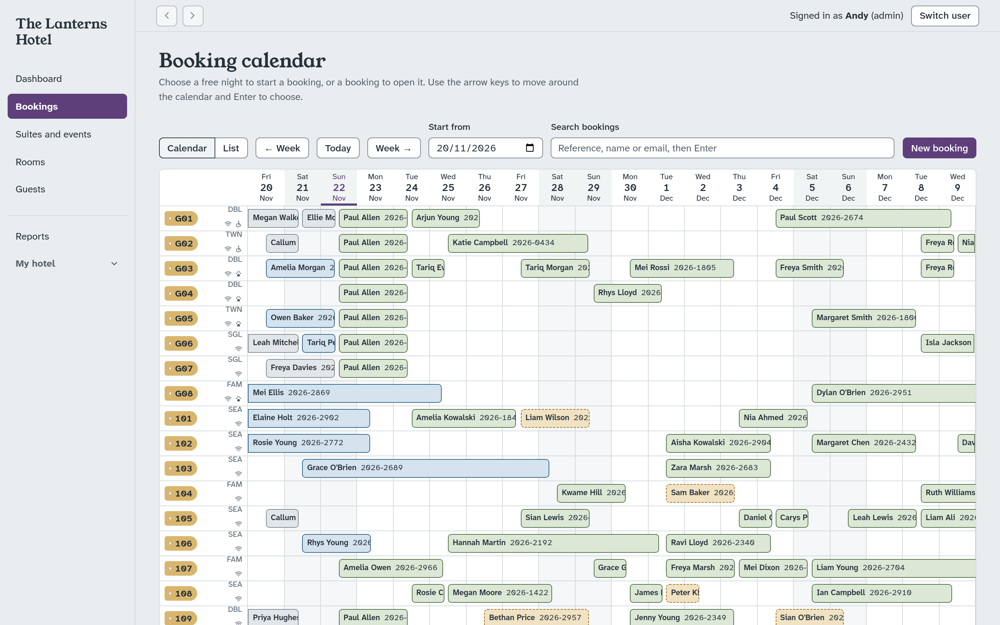
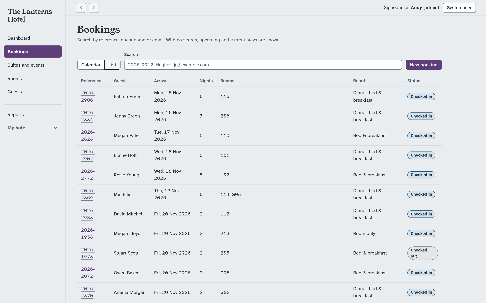
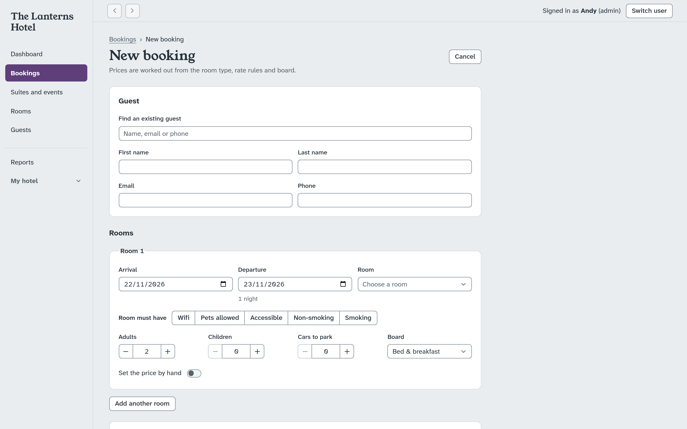
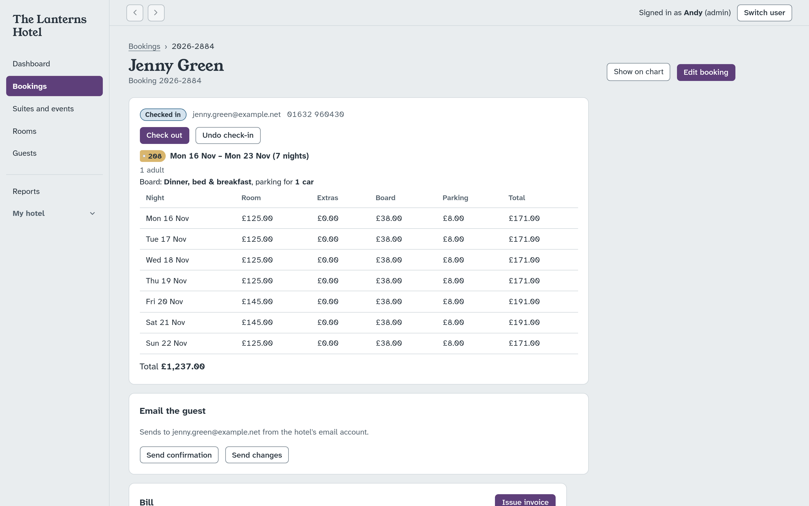

# Bookings

**▶ [Watch a booking taken over the phone](https://youtu.be/jC87SadvN1o)**

**Bookings** has two views, switched at the top of the page: the **Calendar** and the **List**.

## The calendar
Every room down the side, the coming nights across the top. Each booking is a bar across its nights, coloured by status: provisional, confirmed, checked in or checked out. Each room shows its type and small icons for its features (wifi, pets allowed, accessible, smoking).

<picture>
  <source media="(prefers-color-scheme: dark)" srcset="images/calendar-dark.webp">
  
</picture>

- **← Week**, **Today** and **Week →** move along; **Start from** jumps to a date.
- Click a free night to start a booking for that room and date.
- Click a booking to open it in a side panel: check in or out, see the price, or open the full booking.
- The arrow keys move around the calendar and Enter chooses.
- **Search bookings** finds a booking by its number, the guest's name or email; press Enter and the results open in the List view.

## The list
Upcoming and current stays, or the results of a search, with arrival, nights, rooms, board and status.

<picture>
  <source media="(prefers-color-scheme: dark)" srcset="images/bookings-list-dark.webp">
  
</picture>

## Taking a booking
Press **New booking** (or click a free night on the calendar).

<picture>
  <source media="(prefers-color-scheme: dark)" srcset="images/new-booking-dark.webp">
  
</picture>

- **Guest:** type in *Find an existing guest* to reuse someone's details, or fill in a new guest.
- **Rooms:** for each room, the **Arrival** and **Departure** dates, the **Room**, **Adults**, **Children**, **Cars to park** and **Board**. **Add another room** for families and groups.
- **Room must have:** press Wifi, Pets allowed, Accessible, Non-smoking or Smoking and rooms that don't match are greyed out in the room list. Rooms already taken on those nights are greyed out too.
- **The price** is worked out as you go and shown night by night: the room (with any seasonal or weekend rates), extra guests, board and parking. An admin can **Set the price by hand** for an agreed rate.
- **Source** (phone, email, walk-in, website, agent, other) and **Status** (provisional or confirmed), and notes.

Press **Make booking**. It gets a number such as *2026-0042*. A room can never be double-booked: the app checks, and so does the database.

## Changing and cancelling
Open the booking and press **Edit booking** to change dates, rooms, guests or board; the price is worked out again. A booking keeps the price it was given unless you change the room, dates, guests, board or cars.

<picture>
  <source media="(prefers-color-scheme: dark)" srcset="images/booking-dark.webp">
  
</picture>

**Cancel booking** frees the room. **Mark provisional** and **Confirm** move a booking between provisional and confirmed.

## Emailing the guest
On a booking, **Email the guest** sends a confirmation, the changes, or a cancellation, from the hotel's own email account (see [Setting up your hotel](setup.md)). Each email sent, or failed, is listed on the booking.

[Back to the guide](README.md)
