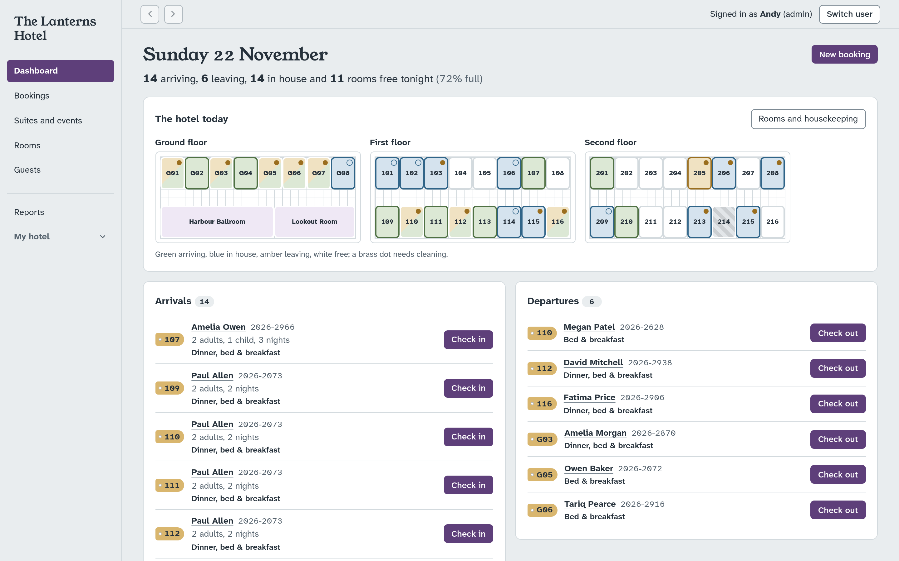
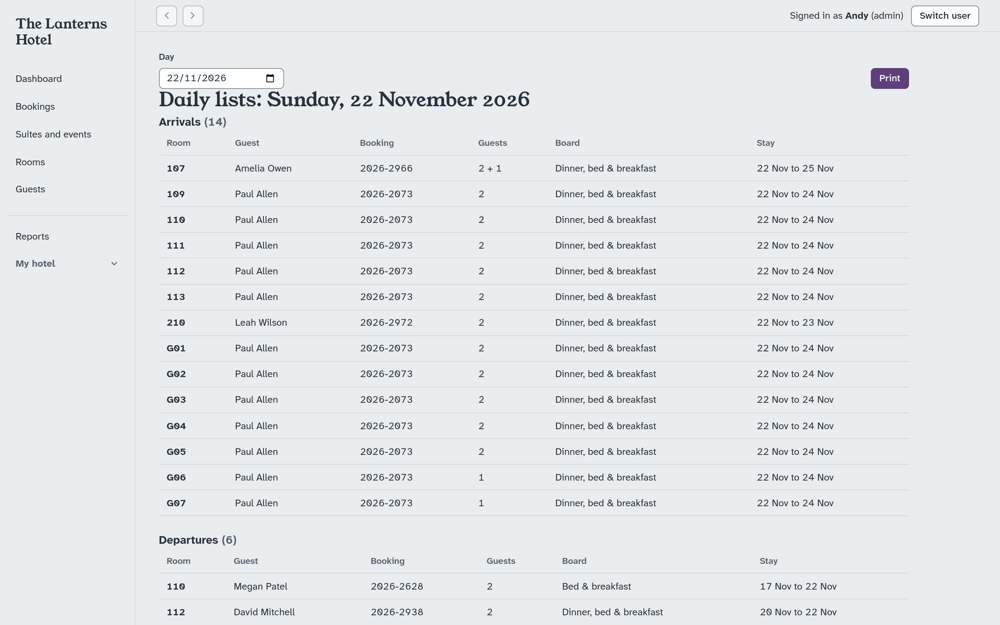

# Front desk

**▶ [Watch check-in, dinner on the bill and check-out](https://youtu.be/H9vWlVG19M4)**

## The dashboard
The first page you see. It fits on one screen:

<picture>
  <source media="(prefers-color-scheme: dark)" srcset="images/dashboard-dark.webp">
  
</picture>

- **Today in a sentence:** how many are arriving and leaving, how many are in house, how many rooms are free tonight and how full the hotel is.
- **The hotel today:** a small plan of each floor. Rooms are coloured green for arriving, blue for in house, amber for leaving and white for free; a brass dot means the room needs cleaning. Click a floor to open **Rooms**.
- **Arrivals:** each guest due today, with room, booking number, guests, nights and board, and a **Check in** button.
- **Departures:** each guest leaving today, with a **Check out** button.
- **Events in the next two weeks:** weddings, conferences and dinners coming up, and any rooms held for them that go back on sale soon.
- A warning if no backup has been taken in the last day.

## Checking in and out
Press **Check in** on the dashboard, or open the booking and press **Check in** there. Checking out is the same with **Check out**; settle the bill first (see [Bills and payments](bills.md)).

Made a mistake? A booking has **Undo check-in** and **Undo check-out**.

If a guest doesn't arrive, open the booking and press **No-show**: the room becomes free for other bookings. **Reinstate** brings a cancelled or no-show booking back.

## Daily lists
Under **Rooms**, **Daily lists** shows today's **Arrivals**, **Departures** and everyone **Staying tonight**, with their board, ready to **Print** for the kitchen and housekeeping. Choose another day to plan ahead.

<picture>
  <source media="(prefers-color-scheme: dark)" srcset="images/daily-lists-dark.webp">
  
</picture>

[Back to the guide](README.md)
