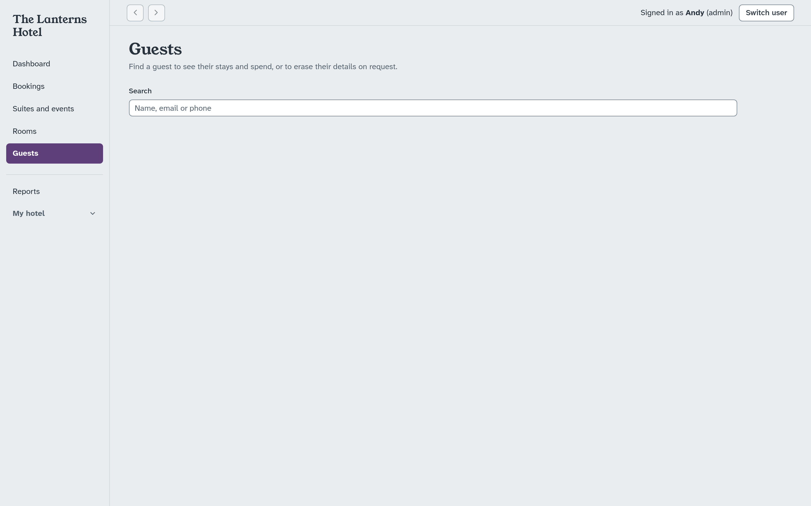
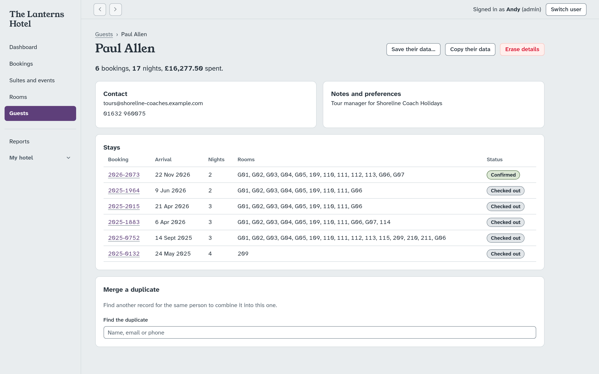

# Guests

**▶ [Watch guests and data protection](https://youtu.be/xnGgMeCaw0w)**

**Guests** lists everyone who has stayed or booked; search by name, email or phone.

<picture>
  <source media="(prefers-color-scheme: dark)" srcset="images/guests-dark.webp">
  
</picture>

Each guest's page shows their contact details, **Notes and preferences**, every stay and what they've spent.

## Duplicates
The same person sometimes gets booked twice under slightly different details. An admin can **Merge a duplicate**: choose which record to keep, and the other one's bookings, suite hire and events move across. Blank details are filled in from the duplicate and both sets of notes are kept.

<picture>
  <source media="(prefers-color-scheme: dark)" srcset="images/guest-dark.webp">
  
</picture>

## Data protection requests
- **Save their data…** (or **Copy their data**) gives everything held about a guest, for a subject access request.
- **Erase details** removes a guest's personal details but keeps the bookings, so the accounts still add up. Admins only.

[Back to the guide](README.md)
