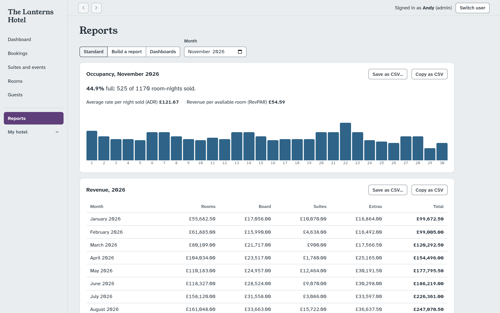
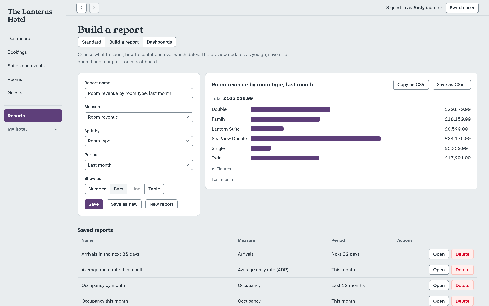
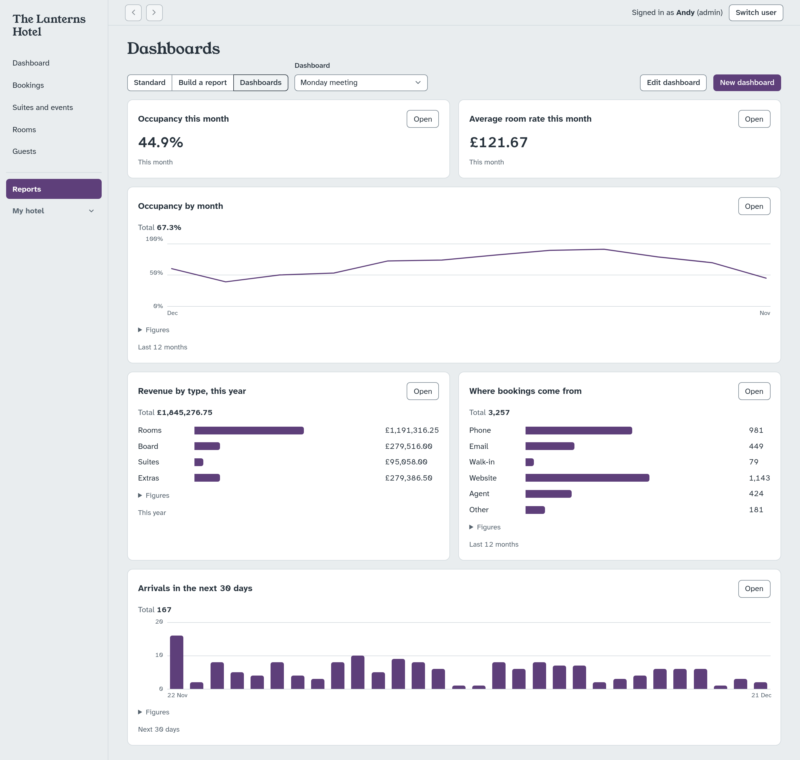

# Reports

**▶ [Watch building reports and dashboards](https://youtu.be/6-SPKQ1CB9w)**

Reports are for admins. **Reports** has three views: **Standard**, **Build a report** and **Dashboards**.

## Standard reports
For a chosen month: occupancy night by night, revenue by month (rooms, board, suites, extras), and the average daily rate (ADR) and revenue per available room (RevPAR). **Copy as CSV** or **Save as CSV…** for a spreadsheet.

<picture>
  <source media="(prefers-color-scheme: dark)" srcset="images/reports-dark.webp">
  
</picture>

## Build a report
Choose:
- a **Measure**: 24 of them, from occupancy, room revenue, ADR and RevPAR to arrivals, cancellations, average length of stay and lead time, payments and deposits, suite hours, events and attendees, and new and returning guests;
- what to **Split by**: day, week, month or year, or room type, floor, room, board, booking source, status, revenue type, payment method, suite or event type (only the splits that make sense for the measure are offered);
- the **Period**: fixed dates, or a relative one like *last month* or *next 30 days* that always shows current figures;
- **Show as** a number, bars, a line or a table.

<picture>
  <source media="(prefers-color-scheme: dark)" srcset="images/report-builder-dark.webp">
  
</picture>

The preview updates as you go. Save it under a name to open it again, or copy or save it as CSV.

## Dashboards
Put saved reports side by side on a dashboard: a "Monday meeting" or "Month end" page. Add up to 12, put them in order and make any of them full width. Every time you open it, the figures are current.

<picture>
  <source media="(prefers-color-scheme: dark)" srcset="images/report-dashboard-dark.webp">
  
</picture>

[Back to the guide](README.md)
