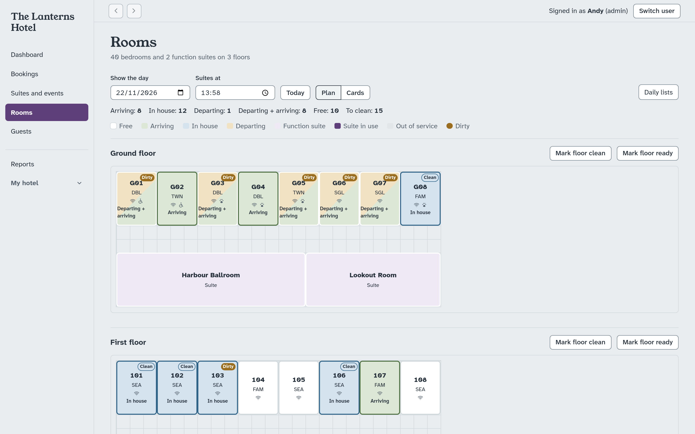
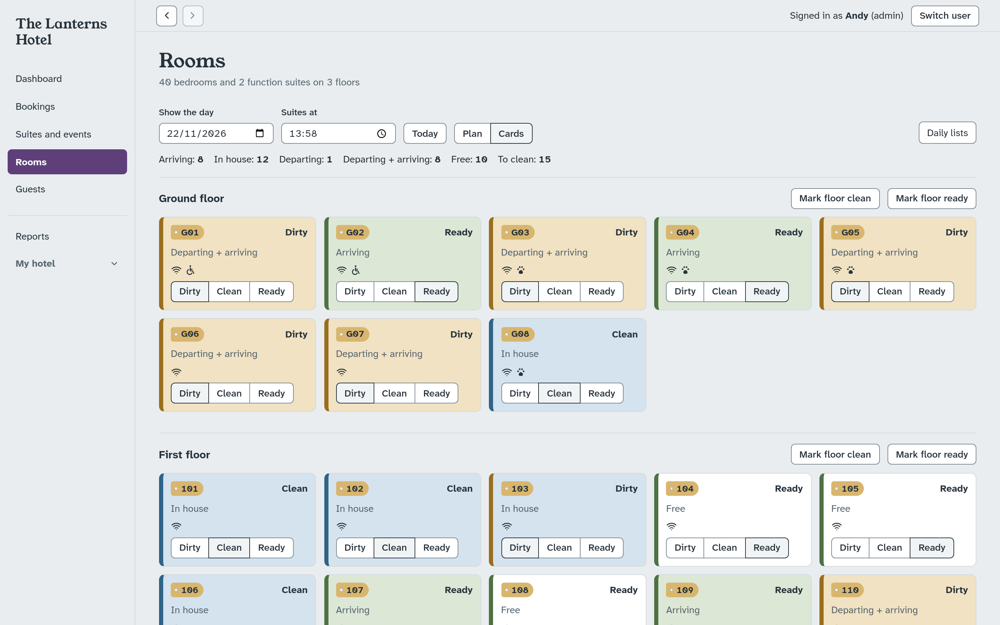

# Rooms and housekeeping

**▶ [Watch housekeeping](https://youtu.be/VEVz8HKKmKA)**

**Rooms** shows every floor, one under another, as a **Plan** or as **Cards**.

## The plan
Each floor is drawn as it's laid out. Rooms are coloured by what's happening on the chosen day: free, arriving, in house, departing, or out of service. Small icons show each room's features. Function suites show whether they're in use at the time chosen under **Suites at**.

<picture>
  <source media="(prefers-color-scheme: dark)" srcset="images/rooms-dark.webp">
  
</picture>

Click a room to see who's in it (booking, dates and board), mark it **Dirty**, **Clean** or **Ready**, or **Book this room**.

The counts at the top give arriving, in house, departing, departing + arriving (same-day turnovers), free and **To clean**.

## Housekeeping

<picture>
  <source media="(prefers-color-scheme: dark)" srcset="images/housekeeping-dark.webp">
  
</picture>
- Every morning, every room slept in last night is **Dirty** until someone marks it, so stayovers get serviced as well as departures.
- Mark rooms **Clean** as they're done and **Ready** once they've been checked.
- **Mark floor clean** and **Mark floor ready** do a whole floor at once.
- The **Cards** view is a simple list of rooms with the three buttons, handy on a tablet for housekeepers.

## Room features
Each bedroom can have **Wifi**, **Pets allowed**, **Accessible** and **Smoking**; a room without Smoking is non-smoking. An admin sets them in **My hotel → Floors and layout**. They show as icons on the plan, the cards and the booking calendar, and the booking form can show only rooms that have them.

[Back to the guide](README.md)
