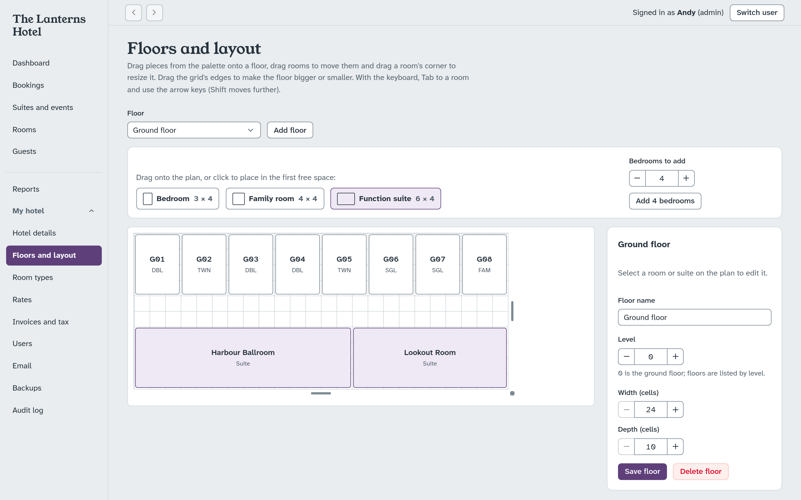
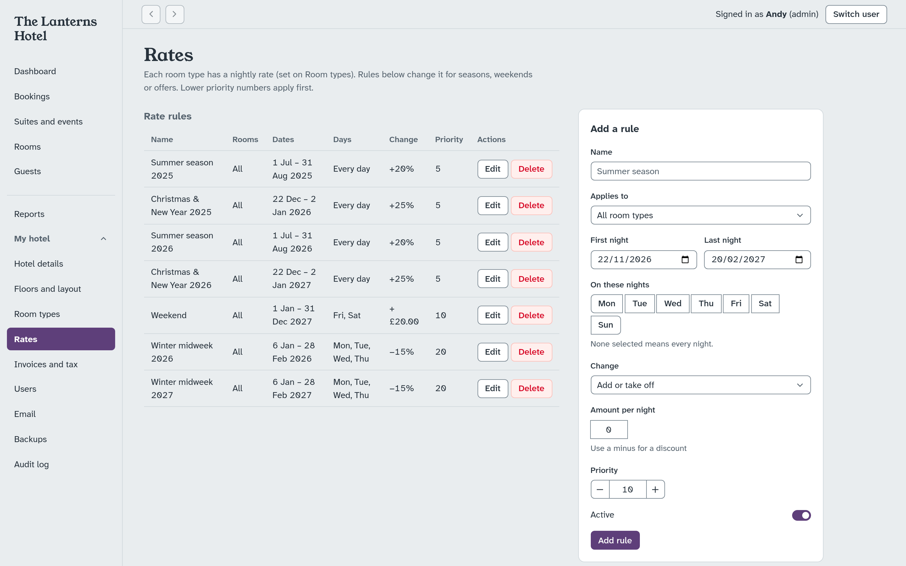

# Setting up your hotel

**▶ [Watch setting up a hotel](https://youtu.be/nY84UvOYTGg)** · **▶ [Watch staff, PINs and the audit log](https://youtu.be/sy0wPAltp5w)**

Setup is under **My hotel** in the menu, for admins.

<picture>
  <source media="(prefers-color-scheme: dark)" srcset="images/setup-floors-dark.webp">
  
</picture>

- **Hotel details:** name, address, contact details, currency, check-in and check-out times, and how soon the app locks itself when nobody's using it.
- **Floors and layout:** draw each floor by dragging bedrooms and function suites onto a grid. For each room, set its number, room type and features (wifi, pets allowed, accessible, smoking), or mark it out of service. For suites, set the capacity for each layout and the hire prices.
- **Room types:** for example Single, Double, Twin and Family, with their occupancy and prices (the room, an extra adult and a child, per night).
- **Rates:** rate rules change prices for dates, days of the week or room types (summer, weekends, special offers). **Board options** such as Room only and Bed & breakfast are priced per adult and child per night. **Parking** is priced per car per night.
- **Invoices and tax:** VAT rates and which applies to rooms, board, suites, food, drinks and other charges; whether prices include VAT; the invoice number prefix and footer.
- **Users:** add staff and admins, each with their own PIN; turn off people who've left (they stay in the audit log). ▶ [Watch](https://youtu.be/sy0wPAltp5w)
- **Email:** connect the hotel's email account (Gmail works with an app password, kept in the computer's secure password store, never in the database), send a test, and edit the confirmation, changes and cancellation emails with placeholders such as the guest's name and dates.
- **Backups:** see [Backups](backups.md).
- **Audit log:** who changed what, and when.

<picture>
  <source media="(prefers-color-scheme: dark)" srcset="images/setup-rates-dark.webp">
  
</picture>

[Back to the guide](README.md)
