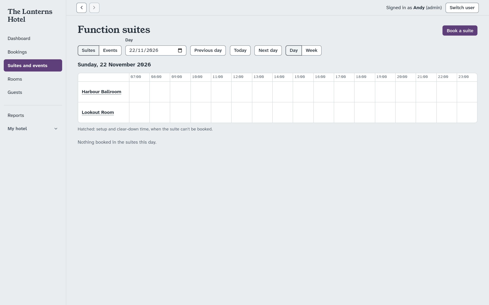
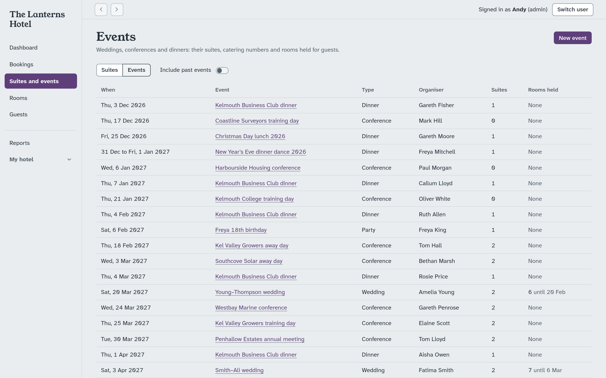
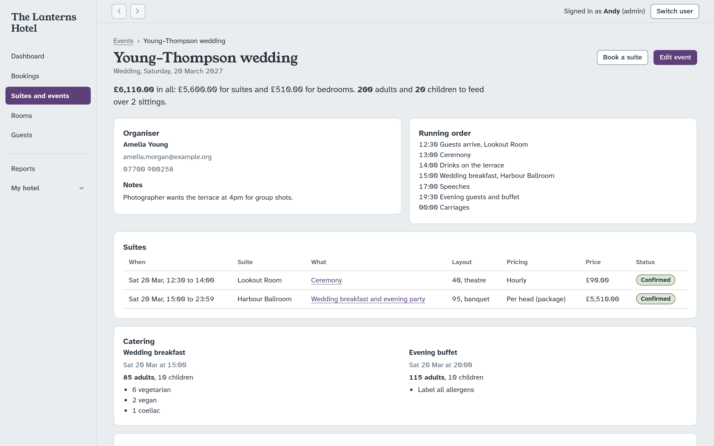

# Suites and events

**▶ [Watch a wedding: suites, catering and a room block](https://youtu.be/46p84bNiXc4)**

**Suites and events** has two views: the **Suites** diary and the **Events** list.

## Suite hire
The diary shows each function suite by **Day** or **Week**, from early morning to midnight. **Book a suite** to hire one:

<picture>
  <source media="(prefers-color-scheme: dark)" srcset="images/suites-dark.webp">
  
</picture>

- the suite, the date and the start and end times, with time to set up and clear down;
- the **Layout** (theatre, boardroom, banquet, cabaret or reception) and the number of people, checked against the suite's capacity for that layout;
- the **Pricing**: by the hour, half day, full day, per head, or a price set by hand. The price is fixed when booked.

A suite can't be double-booked, including its set-up and clear-down time.

## Events
An event (a wedding, conference, dinner or party) brings everything together:

<picture>
  <source media="(prefers-color-scheme: dark)" srcset="images/events-dark.webp">
  
</picture>

- the organiser and dates, and the **Running order**;
- the suites it uses;
- **Catering** sittings, with numbers of adults and children and dietary needs;
- **Rooms held:** a block of bedrooms for guests at a group rate, with a release date. Rooms not taken up by then go back on sale; the dashboard warns two weeks ahead.

<picture>
  <source media="(prefers-color-scheme: dark)" srcset="images/event-dark.webp">
  
</picture>

[Back to the guide](README.md)
